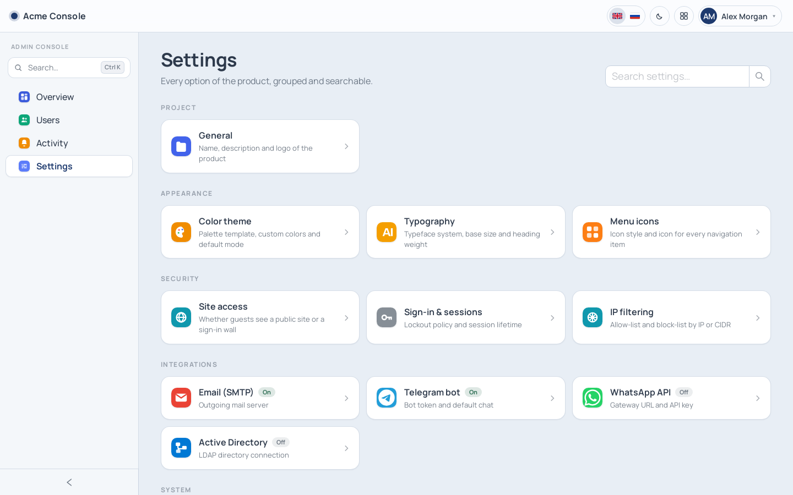
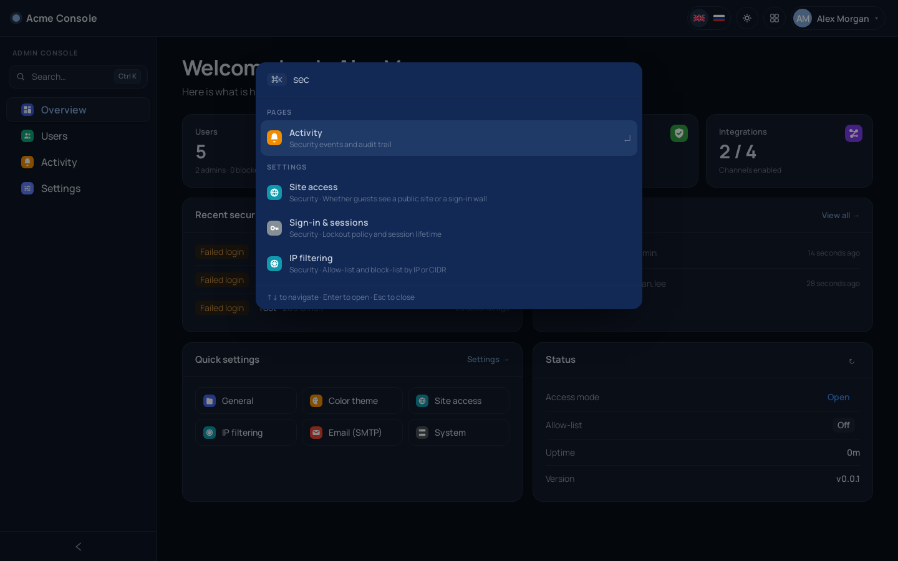
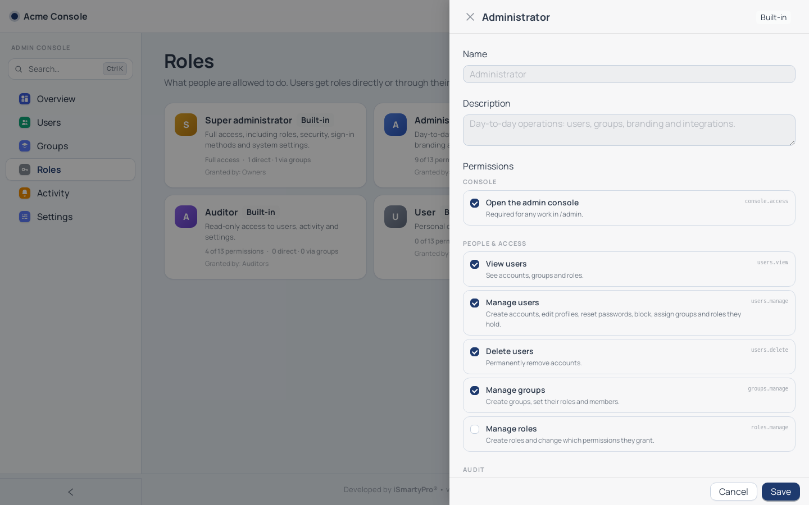
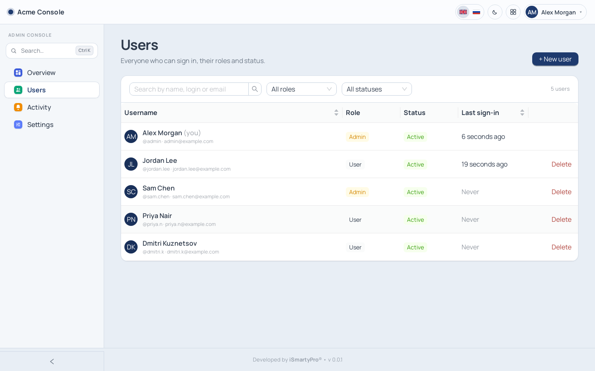
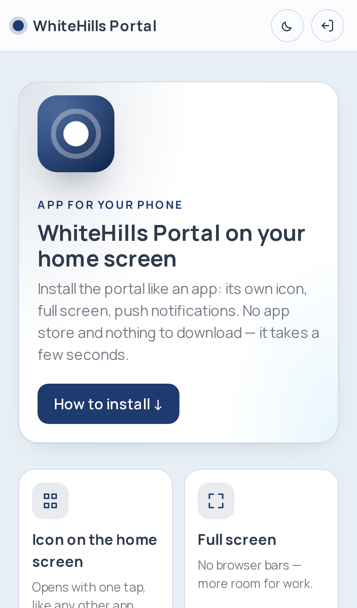
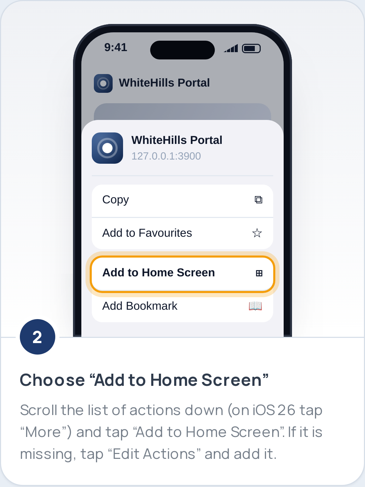

<div align="center">

# iApp-Skeleton

**A production-ready starter for web apps — sign-in, roles, admin console, setup wizard, API and a module platform, already built, themed and secured.**

Clone it, point it at PostgreSQL, finish `/setup`, and spend your first week on your product instead of on login screens.

[](LICENSE)


</div>

---

## Contents

- [Why iApp-Skeleton](#why-iapp-skeleton)
- [Features](#features)
- [Screenshots](#screenshots)
- [Tech stack](#tech-stack)
- [Quick start](#quick-start)
- [Local development](#local-development)
- [Project structure](#project-structure)
- [Building your product on it](#building-your-product-on-it)
- [Configuration](#configuration)
- [Deploying behind a reverse proxy](#deploying-behind-a-reverse-proxy)
- [Security](#security)
- [Operations](#operations)
- [Testing](#testing)
- [Documentation](#documentation)
- [Roadmap](#roadmap)
- [Contributing](#contributing) · [License](#license)

---

## Why iApp-Skeleton

Every internal tool, client portal or SaaS MVP starts with the same weeks of groundwork: authentication, users and roles, an admin panel, branding, settings, Docker packaging and a way to deploy. That groundwork is rarely done carefully — and it is exactly where security holes and UX debt pile up.

iApp-Skeleton is that groundwork done once, properly, and kept small:

- **Plain and readable.** Express + `pg` + React. No ORM, no meta-framework, nothing to unlearn.
- **Secure by default.** httpOnly sessions, bcrypt, lockouts, IP filtering, upload sniffing, a setup wizard that locks itself, a container that does not run the app as root.
- **Looks finished on day one.** A themeable design system with dark mode, five interface languages, a searchable settings hub and a ⌘K command palette.
- **Built to grow.** Your domain lives in modules: a module plugs into users, roles, settings, navigation, help, the API and the dashboard. Four reference modules show how.

## Features

| Area | What you get |
|------|--------------|
| **First run** | Setup wizard: database → super administrator → open or closed site. Protected by a `SETUP_TOKEN` that `make env` generates; locks itself for good once finished. |
| **Sign-in** | Password, Active Directory / LDAP (group mapping, auto-provisioning), Google, Telegram Login, one-time codes by email, Telegram or WhatsApp, magic links — each switched on per integration. |
| **Access control** | Roles built from a permission catalog, groups that grant roles, five built-in roles, escalation-proof assignment, last-super-admin protection, *sign in as* for support. |
| **Sessions** | httpOnly `SameSite=Lax` JWT cookie, bcrypt, per-user and per-IP lockout, rate limits, revocation on any access change, *sign out everywhere*. |
| **User cabinet** | Profile and avatar, language, theme and time zone, password, linked accounts, notification preferences, active sessions, personal API tokens. |
| **Admin console** | Overview, users, groups, roles, security activity log, API tokens and webhooks, and a searchable settings hub for everything configurable. |
| **Design system** | Color templates × light/dark, custom colors, typography presets, colored or monochrome menu icons, live preview, separate dark-theme logo. |
| **Module platform** | `/apps` launcher, `/app/<id>` pages, per-module switch and settings, requirements between modules, versions and changelogs; a disabled module is invisible in the UI and the API. |
| **Dashboard** | Personal widgets: welcome, quick actions, notifications, recent files, new knowledge base materials, people, clock, note — rearranged per person. |
| **Files** | My files, *Shared with me* and team spaces; sharing with people and groups; public links with password, expiry and view-only mode; trash, search, quotas, in-browser viewers and online editing (Collabora). |
| **Knowledge base** | Folders of any depth with articles, files and links; access per folder and material; public links with a readable address, password and expiry; PDF, Word, Excel and PowerPoint in the browser. |
| **Robot assistant** | An animated helper on every page that greets people in new sections and answers from the help content. |
| **Help and tours** | Field hints, a searchable help center and guided tours, all translated. |
| **Notifications** | One notification center: the bell, Web Push, email (SMTP or Gmail), Telegram, WhatsApp, Mattermost — with per-person preferences and quiet hours. |
| **Public API** | REST API at `/api/v1` with tokens that act on behalf of a person: access templates, per-area levels, path rules, IP lists, expiry and rate limits; signed webhooks with retries; request log; developer portal with a live console and OpenAPI 3.1. |
| **Installable app** | PWA: home-screen icon, push, offline screen and an illustrated install guide for iPhone, Android and desktop. |
| **Landing page** | A one-page public landing (features, how it works, FAQ, contact) for open mode — all texts in `locales/<lang>/landing.js`. |
| **Languages** | Russian, English, Kyrgyz, Turkish and Chinese across the interface, emails and help — with a check that keeps them complete. |
| **Operations** | One production container (nginx + Node), hot-reload dev stack, `/health` and `/ready`, a Makefile for every routine task, semver `VERSION` baked into the image. |

## Screenshots

| Settings hub | Command palette (⌘K) |
|---|---|
|  |  |
| **Live theme preview (dark)** | **Unsaved-changes bar** |
|  |  |
| **Sign-in with a one-time code** | **Roles and permissions** |
|  |  |
| **Sign-in methods** | **User management** |
|  |  |
| **IP filtering with self-lockout guard** | **Mobile** |
|  |  |

| Install guide (iPhone) | Illustrated step |
|---|---|
|  |  |

## Tech stack

| Layer | Choice |
|-------|--------|
| Frontend | React 18, React Router 6, Ant Design 5, Vite 5 |
| Backend | Node.js 22 LTS, Express 4, `pg`, jsonwebtoken, bcryptjs, helmet, express-rate-limit, multer, nodemailer |
| Database | PostgreSQL 14+ (external — one server can host many apps) |
| Runtime | One Docker image: nginx serves the SPA and proxies `/api` to Node |
| Tooling | Docker Compose, Make, `node:test` |

## Quick start

**You need:** Docker Engine with Compose v2, and a PostgreSQL 14+ server the container can reach ([how to create the database](docs/postgres-setup.md)).

```bash
git clone git@github.com:ORG/iapp-skeleton.git my-product
cd my-product

make env        # creates .env, generates JWT_SECRET and prints a SETUP_TOKEN
$EDITOR .env    # FRONTEND_URL, DOCKER_NAME, DOCKER_PORT, POSTGRES_*
make network    # creates the docker-lan network if missing
make up         # builds and starts the production container
make health
```

Open `http://127.0.0.1:8092` (or your `DOCKER_PORT`) — you land in the **setup wizard**. Enter the `SETUP_TOKEN` that `make env` printed, then:

1. **Database** — host, database, user, password → *Test* → *Save*. Credentials go to `.env`; tables are created.
2. **Administrator** — username and password (10+ characters).
3. **Access** — **Closed** (everyone sees the sign-in form) or **Open** (the public landing; cabinet and console stay private).

> [!IMPORTANT]
> When setup completes, the app writes `SETUP_LOCKED=true` to `.env` and the wizard can never be reopened — not even during a database outage.

## Local development

**With Docker** — source is bind-mounted, both servers hot-reload:

```bash
make dev
```

| URL | Service |
|-----|---------|
| http://127.0.0.1:3020 | Vite dev server (UI) |
| http://127.0.0.1:3021 | Express API |

Run `make dev-rebuild` after changing a `package.json`.

**Without Docker** — Node 22 and a reachable PostgreSQL. Put the connection into `.env` at the repository root (copy `.env.example`), then:

```bash
make install                     # npm ci in both packages
cd src/backend  && npm run dev   # API on :3001 (reads ../../.env)
cd src/frontend && npm run dev   # UI on :3000, proxies /api to :3001
```

On Windows without `make`, run `npm ci` in `src/backend` and `src/frontend` instead of `make install`.

## Project structure

```
.
├── Dockerfile · Dockerfile.dev · docker-compose*.yml · nginx.conf · start.sh
├── Makefile                    # env, up, dev, logs, release, database helpers
├── VERSION                     # the single source of the app version
├── docs/                       # developer guides (see Documentation)
└── src/
    ├── backend/
    │   ├── config/             # env bootstrap, PostgreSQL pool, paths, version
    │   ├── middleware/         # auth, IP guard, setup guard, uploads, errors
    │   ├── routes/             # auth, setup, account, admin, platform, notifications, pwa
    │   ├── services/           # users, rbac, settings, security, sign-in, integrations, notifications, scheduler
    │   ├── api/                # public API: tokens, scopes, templates, webhooks, OpenAPI
    │   ├── modules/            # module platform + files, kb, dashboard, assistant
    │   ├── locales/            # server texts (emails, notifications) in 5 languages
    │   └── test/               # node:test unit tests
    └── frontend/src/
        ├── admin/              # console structure: navigation + settings page map
        ├── modules/            # module UI: registry, manifest, files, kb, dashboard, assistant
        ├── pages/              # Home (landing), Login, SetupWizard, account/*, admin/*
        ├── help/ · tour/       # help center and guided tours
        ├── components/         # header, command palette, icons, UI kit
        ├── context/ · hooks/   # Auth, Settings, Locale, Theme; settings forms
        ├── locales/            # interface texts: <lang>/<namespace>.js
        └── theme/              # color templates, typography presets
```

## Building your product on it

| You want to… | Start here |
|---|---|
| Rename and brand the project | [docs/adapt.md](docs/adapt.md) — names, logos, `.env`, landing texts |
| Add your domain (orders, devices, bookings…) | [docs/modules.md](docs/modules.md) — a module with its tables, API, page, settings, permissions, help and tests |
| Add a settings screen, page, endpoint or integration | [docs/extending.md](docs/extending.md) |
| Change the landing page | `src/frontend/src/locales/<lang>/landing.js` and `src/frontend/src/pages/Home.jsx` |
| Add or edit texts | [docs/i18n.md](docs/i18n.md) — every text in all five languages, checked by `npm run i18n:check` |

Adding a settings screen, for example, is three steps — the sidebar, settings hub, command palette and icon editor follow automatically:

```js
// 1. src/frontend/src/admin/navigation.js — add an item to a group
{ id: 'billing', defaultIcon: 'chart', keywords: 'billing invoices' }

// 2. src/frontend/src/admin/settingsPages.js — register the screen (lazy chunk)
billing: lazy(() => import('../pages/admin/settings/Billing')),

// 3. src/frontend/src/locales/<lang>/settings.js — billing.title / billing.desc
```

Modules you do not need can be switched off in **Settings → Modules** or removed entirely.

## Configuration

Bootstrap configuration lives in `.env` (git-ignored; template: [`.env.example`](.env.example)). Everything else — name, logos, theme, integrations, security policy — is stored in PostgreSQL and edited in the console.

| Variable | Default | Purpose |
|----------|---------|---------|
| `DOCKER_NAME` / `DOCKER_PORT` | `iapp-skeleton` / `8092` | Container name and published HTTP port |
| `FRONTEND_URL` | `http://localhost:8092` | Public origin: CORS, and `Secure` cookies when `https://` |
| `JWT_SECRET` | generated by `make env` | Session signing key — **required** in production |
| `SETUP_TOKEN` | generated by `make env` | Secret the setup wizard asks for until setup is locked |
| `SETUP_LOCKED` | written by the app | Keeps the wizard closed after setup |
| `POSTGRES_*` / `DATABASE_URL` | — | Database connection (the wizard can write `POSTGRES_*`) |
| `TRUST_PROXY_HOPS` | `1` | Reverse proxies in front of Express (see below) |
| `COOKIE_SECURE` | unset | Force `Secure` cookies when TLS terminates upstream |
| `TZ` / `UPLOAD_DIR` | `UTC` / `/app/uploads` | Time zone and file storage |

Full reference: [docs/configuration.md](docs/configuration.md).

## Deploying behind a reverse proxy

The container runs nginx, which counts as **one** proxy hop. With another proxy in front (host nginx, Traefik, Nginx Proxy Manager, Cloudflare):

```env
FRONTEND_URL=https://app.example.com
TRUST_PROXY_HOPS=2
```

and forward the client address:

```nginx
location / {
    proxy_pass         http://127.0.0.1:8092;
    proxy_set_header   Host              $host;
    proxy_set_header   X-Real-IP         $remote_addr;
    proxy_set_header   X-Forwarded-For   $proxy_add_x_forwarded_for;
    proxy_set_header   X-Forwarded-Proto $scheme;
}
```

> [!WARNING]
> With the wrong hop count every visitor appears to have the proxy's IP — one brute-force attempt locks everyone out and IP allow-lists stop working. Too high a value lets clients spoof their IP.

## Security

The threat model and go-live checklist are in [docs/security.md](docs/security.md). Highlights:

- **Access control** — permission-checked routes, no privilege escalation (you can only grant what you hold), and the product can never lose its last super administrator.
- **Sessions and sign-in** — httpOnly `SameSite=Lax` cookies, `Secure` on HTTPS; password or access changes revoke every outstanding session; one-time codes are short-lived, single-use, hashed and rate-limited; lockouts per username and per IP.
- **Setup wizard** — a generated `SETUP_TOKEN`, only the browser that created the administrator may finish it, locked for good afterwards.
- **API tokens** — they only narrow their owner's rights, never widen them, and can never touch credentials, sessions or linked sign-in identities.
- **Public links** — passwords of 8+ characters, brute-force limits per address and per link, view-only mode, anonymous requests rate-limited.
- **Data and files** — parameterized SQL everywhere, write-only integration secrets, upload magic-byte checks, user files served with a sandboxing CSP.
- **Container** — the app runs as an unprivileged user, base images are pinned by digest, the dev stack listens on localhost only.

Report vulnerabilities privately — see [SECURITY.md](SECURITY.md).

## Operations

```bash
make help    # every target with a description
```

| Task | Command |
|------|---------|
| Start / stop / rebuild production | `make up` · `make down` · `make rebuild` |
| Health, readiness, status | `make health` · `make ready` · `make status` |
| Logs and shell | `make logs` · `make logs-tail LINES=200` · `make shell` |
| Development stack | `make dev` · `make dev-logs` · `make dev-down` |
| Release a version | `make bump-patch` (or `-minor`, `-major`) → `make rebuild` |
| Database helpers | `make psql` · `make sql SQL="SELECT 1"` · `make db-setup PASSWORD=…` |
| Sample users | `make seed-demo` (no passwords; for demos and staging) |

Backups, upgrades and troubleshooting: [docs/operations.md](docs/operations.md).

## Testing

```bash
make test                          # backend unit tests + frontend production build
cd src/backend  && npm test        # node:test unit tests
cd src/backend  && npm run check   # syntax check of every backend file
cd src/frontend && npm run i18n:check
```

Database tests (`*.db.test.js`) run against a throwaway database when their environment variables are set; see each file's header.

## Documentation

| Guide | Contents |
|-------|----------|
| [Getting started](docs/getting-started.md) | From `git clone` to a running product |
| [Architecture](docs/architecture.md) | Request flow, data model, frontend areas, UI kit |
| [Adapting the skeleton](docs/adapt.md) | Renaming, branding and what not to rewrite |
| [Modules](docs/modules.md) | The module platform and how to write a module |
| [Extending](docs/extending.md) | Recipes: settings screens, pages, endpoints, integrations, tours, demo data |
| [Access control & sign-in](docs/access-control.md) | Roles, groups, permissions, sign-in methods |
| [Public API](docs/public-api.md) | Tokens, access templates, webhooks, developer portal, OpenAPI |
| [HTTP API](docs/api.md) | Every endpoint with its guard |
| [Notifications](docs/notifications.md) | Notification center, channels, Web Push, scheduler |
| [Integrations](docs/integrations.md) | Email, Telegram, WhatsApp, Wazzup, Mattermost, Google, documents, Active Directory |
| [Dashboard](docs/dashboard.md) · [Files](docs/files.md) · [Knowledge base](docs/knowledge-base.md) · [Robot assistant](docs/assistant.md) | The reference modules |
| [In-app help](docs/help.md) · [Localization](docs/i18n.md) | Help content, tours and the five languages |
| [Online document editing](docs/office-editing.md) · [Link previews](docs/link-previews.md) · [PWA](docs/pwa.md) | Collabora, messenger cards, the installable app |
| [Time zones and formats](docs/datetime.md) | Portal and personal time zones, formats, rules for code |
| [Configuration](docs/configuration.md) · [Security](docs/security.md) · [Operations](docs/operations.md) | Running it in production |
| [PostgreSQL](docs/postgres-setup.md) · [Publishing to GitHub](docs/github.md) | Database setup, first push without leaking secrets |
| [Changelog](CHANGELOG.md) | Release history |

## Roadmap

- [ ] Module generator (`make module NAME=orders`)
- [ ] GitHub Actions workflow: tests, database tests, image build
- [ ] Encrypt integration secrets at rest
- [ ] Versioned SQL migrations
- [ ] End-to-end tests with Playwright
- [ ] TOTP two-factor authentication and passkeys

## Contributing

Contributions that keep the skeleton small, secure and easy to build on are welcome. Read [CONTRIBUTING.md](CONTRIBUTING.md) before opening a pull request; security-sensitive changes need a short threat note.

## License

[MIT](LICENSE) © iApp-Skeleton. Developed by [iSmartyPro](https://www.ismarty.pro).
